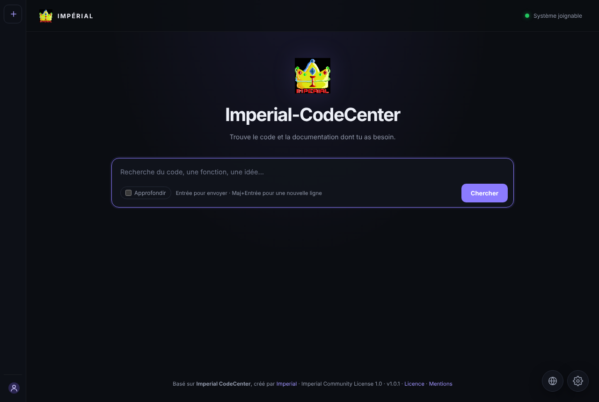
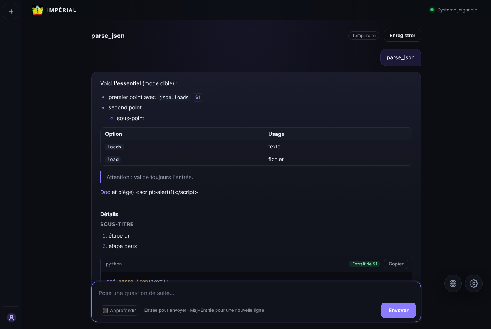

# Imperial CodeCenter

**Version 1.0.4** — Moteur de recherche de code et de documentation, assisté par IA.

Exception : le créateur et les membres de l'équipe Imperial Corporation ne sont pas tenus par ces obligations (article 5.8, personnelle et non transmissible).

Développeur en chef : **yolezz** · Organisation : **Imperial** · Idée originale : **HyperDemoned**

Basé sur **Imperial CodeCenter**, créé par **Imperial** — <https://imperial-corporation.pages.dev/icc> · Dépôt : <https://github.com/Imperial-Corporation/Imperial-CodeCenter> · Licence : [Imperial Community License 1.0](LICENSE) (libre et gratuite, code ouvert obligatoire, usage payant interdit).

Documentation détaillée : [`docs/`](docs/README.md).



Les fichiers déposés dans les dossiers surveillés sont indexés automatiquement. Une question en langage naturel retrouve les fichiers pertinents, les compresse au budget du modèle, puis un fournisseur IA (local ou distant) rédige une réponse structurée, avec des sources vérifiables.

## Architecture

```
frontend/ (HTML/CSS/JS)  ──HTTP──▶  api/ (FastAPI + Python)  ──PyO3──▶  engine/ (Rust)  ──▶  PostgreSQL
                                         │                                  └─▶ fichiers (dossiers surveillés)
                                         └──HTTP──▶ fournisseurs IA (18 : Ollama, OmniRoute, Claude, OpenAI, Gemini, OpenRouter, Mistral…)
```

| Dossier | Rôle |
|---|---|
| `engine/` | Moteur Rust (module Python `codecenter_engine`) : watcher et indexation, recherche, lecture sécurisée, statistiques. |
| `api/src/main.py` | Application FastAPI : frontend, santé, statistiques, WebSocket, routes IA. |
| `api/src/icc_ai/` | Orchestration IA (voir ci-dessous). |
| `frontend/` | Interface : accueil, discussion, barre latérale (comptes, discussions enregistrées), panneaux de configuration IA et crawler. |
| `config/` | Migrations SQL, `.env`, service systemd, paramètres de déploiement. |
| `crawler/` | Collecteur GitHub (`icc_crawler`) : licences permissives, planification, objectifs d'arrêt, sécurité disque. |
| `Dockerfile`, `compose.yaml`, `docker/` | Déploiement Docker (voir [docs/docker.md](docs/docker.md)). |
| `.github/` | Workflows CI et publication automatique. |
| `examples/` | 66 scripts d'exemple installés au premier déploiement. |
| `docs/` | Documentation complète en français. |
| `e2e/` | Tests de bout en bout de l'interface (Playwright). |
| `release-notes/` | Texte de chaque release GitHub (`X.Y.Z.md`). |
| `scripts/` | `tag.sh` (publier une version), `icc` (CLI + MCP), `bench.py`, `install.sh` (tout en un), `build.sh`, `deploy.sh`, `release.sh`, `fix_permissions.sh`, `doctor.sh`, `setup_proxy.sh`, `update_cloudflare_ips.sh`, `install_examples.sh`, `clean.sh`. |

Python orchestre les fournisseurs et les outils ; Rust effectue les opérations sur l'index et les fichiers. Python appelle directement les fonctions Rust (aucun appel HTTP interne).

### Fonctions Rust exposées à Python

| Fonction | Rôle |
|---|---|
| `search(query, limit=10, language=None, category=None)` | Recherche (métadonnées PostgreSQL + contenu des fichiers), JSON avec extraits et numéros de ligne. |
| `get_document(document_id, start_line=None, end_line=None, max_bytes=None)` | Lecture d'un fichier indexé, par plage de lignes, plafonnée. |
| `list_filters()` | Langages et catégories présents dans l'index. |
| `scan_status()`, `rescan_now()` | 1.0.4 : progression du passage d'indexation (JSON) et passage immédiat. |
| `get_stats()`, `healt()`, `start_watcher()`, `stop_watcher()` | Existantes, inchangées. |

Les erreurs Rust deviennent `ValueError` (entrée invalide), `LookupError` (introuvable), `PermissionError` (chemin hors des dossiers surveillés) ou `RuntimeError`. Un chemin lu en base n'est jamais ouvert sans être canonicalisé (liens symboliques résolus) et contenu dans `CODECENTER_WATCH_PATHS`.

### Package `icc_ai`

| Module | Rôle |
|---|---|
| `catalog.py` | Fournisseurs pris en charge, valeurs par défaut, réglages avancés (source unique de vérité, aussi lue par le frontend). |
| `config/` | `ConfigStore` (fichier JSON persistant, permissions 0600), `SecretBox` (chiffrement Fernet), validation. |
| `providers/` | Interface `ChatProvider` et un connecteur par protocole : `openai_compat` (OpenAI, Groq, OmniRoute, OpenRouter, Mistral, DeepSeek, xAI, Together, Fireworks, Cerebras, NVIDIA, Cohere, LM Studio, llama.cpp, libre), `anthropic`, `gemini`, `ollama`. |
| `tools/` | Interface `Tool`, registre, outils `search_code`, `read_file`, `get_file_info`, `list_filters`. |
| `compression.py` | Compression sémantique des fichiers au budget du modèle. |
| `sources.py` | Registre des sources : identifiants `S1`, `S2`… attribués par le serveur. |
| `response.py` | Format de réponse, validation de la sortie du modèle, vérification du code cité. |
| `service.py` | Pipeline : recherche → lecture → compression → boucle modèle/outils → validation. |
| `conversation.py` | Modèles de conversation. |
| `chat.py`, `depth.py` | Chatbox en mémoire (outils disponibles) ; profondeur aperçu / ciblé / approfondi. |
| `library.py`, `admin_api.py` | Import avec tags, ZIP, zone de dépôt serveur ; routes d'administration. |
| `accounts.py`, `accounts_api.py` | Comptes (scrypt, sessions par cookie), discussions enregistrées (SQLite). |
| `about.py` | Identité du projet : version, organisation, licence, crédits. |
| `crawl_jobs.py`, `crawler_bridge.py` | Pilotage du crawler (planification, arrêt, état). |
| `proxy.py`, `proxy_config.py` | Intégration Nginx / Cloudflare et génération de la configuration. |
| `api.py` | Routes FastAPI. |

## Installation et lancement

Prérequis : Linux, PostgreSQL, [`uv`](https://docs.astral.sh/uv/), Python ≥ 3.10. Rust (`rustup`, `rustc`, `cargo`) est installé automatiquement s'il manque, et cloudflared aussi en mode Cloudflare.

### Docker (le plus simple)

```bash
cp docker/env.exemple .env      # choisis POSTGRES_PASSWORD (openssl rand -hex 24)
docker compose up -d            # http://127.0.0.1:8000 — crée ton compte en premier (administrateur)
```

L'image (`ghcr.io/imperial-corporation/imperial-codecenter`, amd64 + arm64) est publiée automatiquement par GitHub Actions à chaque tag `vX.Y.Z`. Détails, sauvegardes, mise à jour, publication d'une version : [docs/docker.md](docs/docker.md).

### Développement

```bash
cp config/.env.exemple config/.env    # puis renseigner DATABASE_URL et CODECENTER_WATCH_PATHS
./scripts/build.sh                     # installe les dépendances, compile le moteur, lance l'API
```

L'API écoute sur http://127.0.0.1:8000 (documentation interactive : `/docs`). Les migrations de `config/database/migrations/` doivent être appliquées à la base.

### Production en une commande

```bash
./scripts/install.sh                       # déploie tout, puis lance doctor.sh
./scripts/install.sh --generate-admin-token --proxy cloudflare --server-name code.exemple.fr
```

Détails : [docs/installation.md](docs/installation.md). Étapes séparées :

```bash
./scripts/deploy.sh     # première fois : compte de service, base, dépendances système
./scripts/release.sh    # construit et installe une version, redémarre le service
```

`release.sh` génère `CODECENTER_SECRET_KEY` à la première installation et la conserve ensuite : ne la supprime pas de `/etc/imperial-codecenter/.env`, les clés API enregistrées deviendraient illisibles (il suffirait alors de les ressaisir dans le panneau).

### Variables d'environnement

Les variables principales sont ci-dessous ; la liste complète (import, indexation, proxy…) est dans [docs/configuration.md](docs/configuration.md).

| Variable | Rôle |
|---|---|
| `DATABASE_URL` | Connexion PostgreSQL (obligatoire). |
| `CODECENTER_WATCH_PATHS` | Dossiers surveillés et seuls lisibles (séparés par `:`). |
| `CODECENTER_DATA_DIR` | Données de l'application ; la configuration IA est dans `<dir>/ai/providers.json`. Par défaut `.local/data`. |
| `CODECENTER_SECRET_KEY` | Clé de chiffrement des données serveur (production) ; les clés API des comptes sont, elles, chiffrées par mot de passe. |
| `CODECENTER_SECRET_KEY_FILE` | Alternative : chemin d'un fichier contenant la clé. |
| `CODECENTER_KEY_DIR` | Développement seulement : dossier où une clé est générée si aucune n'est définie (par défaut `.local/`, ignoré par git). |
| `CODECENTER_REGISTRATION` | `open` (défaut) ou `closed` : inscriptions de comptes. |
| `CODECENTER_ADMIN_TOKEN` | Facultatif : jeton d'administration (`Authorization: Bearer`) pour bibliothèque, crawler et santé de l'index ; sinon le premier compte créé est administrateur. |
| `CODECENTER_USER_RATE` | Requêtes par minute et par utilisateur (30 par défaut). |
| `CODECENTER_PROVIDER_NETWORK` | `any` (défaut) ou `public` : refuse les URL de fournisseur vers le réseau local. |

Générer une clé : `python3 -c "import base64,os;print(base64.urlsafe_b64encode(os.urandom(32)).decode())"`

## Configuration de l'IA

Le bouton à engrenage (dans la barre supérieure) ouvre le panneau :

- **Fournisseur** (18) : Ollama, OmniRoute, LM Studio, llama.cpp / vLLM (locaux) ; Claude, OpenAI, Groq, Gemini, OpenRouter, Mistral, DeepSeek, xAI, Together AI, Fireworks AI, Cerebras, NVIDIA NIM, Cohere (distants) ; « compatible OpenAI » pour toute autre URL `/v1`.
- **URL, modèle, clé API** propres au fournisseur ; la clé enregistrée n'est jamais renvoyée au navigateur (le champ reste vide, laisser vide conserve la clé).
- **Advanced features** : délai d'attente, tokens de sortie, fenêtre de contexte, température, nombre maximal d'appels d'outils.
- **Tester la connexion** (liste aussi les modèles disponibles) et **Enregistrer et activer**.

La configuration est **propre à chaque compte** et chiffrée avec une clé protégée par ton mot de passe : personne d'autre (administrateur compris) ne peut lire ni utiliser tes clés. Il faut un compte pour utiliser l'IA. Mot de passe oublié = clés à ressaisir. Les réglages des autres fournisseurs sont conservés quand on change.

Particularités gérées par les connecteurs : système séparé et blocs `tool_use`/`tool_result` (Claude) ; arguments d'outils en chaîne JSON, `max_completion_tokens` vs `max_tokens` (OpenAI-compatibles) ; schémas OpenAPI restreints, `functionCall` sans identifiant, clé en en-tête (Gemini) ; arguments objets, `num_ctx`, modèle sans outils (Ollama, repli automatique sans outils).

## Nouveautés de la 1.0.4

Mise à jour **sans rien changer** : tout est rétrocompatible ([docs/compatibilite.md](docs/compatibilite.md)).

- **Paquet GitHub** (`ghcr.io`, onglet *Packages*) pour **amd64 et arm64**, analysé (Trivy), signé (cosign), avec SBOM et provenance ; **release automatique** à chaque tag, créée avec `./scripts/tag.sh` ([docs/release.md](docs/release.md)).
- **Léger** : profil `lite` / `minimal` / `auto`, index de contenu dans PostgreSQL (la recherche ne relit plus les fichiers), redémarrage sans relecture, pauses et priorités d'indexation, cache de recherche, `compose.lite.yaml` ; pensé pour petits serveurs, PC modestes et **disques durs** ([docs/performance.md](docs/performance.md)).
- **Administration** : comptes (désactiver, réinitialiser, supprimer), inscriptions ouvertes/fermées, progression de l'index en direct, relance, exclusions, ressources du serveur, **métriques Prometheus** ([docs/administration.md](docs/administration.md)).
- **Sauvegarde / restauration** chiffrables, planifiables ([docs/sauvegardes.md](docs/sauvegardes.md)).
- **Jetons d'API par compte**, CLI **`icc`** et **serveur MCP** ([docs/cli-mcp.md](docs/cli-mcp.md)).
- **Interface FR / EN** ([README.en.md](README.en.md)), secrets `*_FILE`, **Podman** ([docs/podman.md](docs/podman.md)), tests e2e Playwright, CodeQL.

## Nouveautés de la 1.0.3

- **Docker** : `Dockerfile` multi-étapes (moteur Rust compilé, image finale sans compilateur, utilisateur non-root, système de fichiers en lecture seule) et `compose.yaml` avec PostgreSQL ; migrations et clé de chiffrement gérées au démarrage.
- **Publication automatique** : GitHub Actions teste (API, crawler, moteur, PostgreSQL, démarrage de l'image) puis, à chaque tag, publie l'image multi-architecture sur ghcr.io, la wheel et le sdist du moteur, et crée la release avec les notes du CHANGELOG. `scripts/version.py` garde toutes les versions cohérentes.
- **Licence** : cas particulier de l'équipe Imperial (article 5.8) : le créateur et les membres de l'équipe Imperial Corporation ne sont pas soumis aux obligations de code ouvert, de gratuité et de non-commercialisation.
- **Crawler en direct** : phase, barre de progression, dépôt en cours, fichiers par dépôt, vitesse, temps restant estimé et derniers fichiers enregistrés, mis à jour chaque seconde.

## Nouveautés de la 1.0.2

Comptes obligatoires, clés API liées au compte et chiffrées par le mot de passe, sécurité renforcée, interface allégée, 66 exemples : voir le [CHANGELOG](CHANGELOG.md).

## Nouveautés de la 1.0.1

- **Interface** : dès qu'une question est posée, l'accueil s'efface pour laisser place à la discussion ; une réponse = une carte aux blocs séparés (synthèse, sections, code coloré, sources repliées, pistes, actions) ; la section « Ajouter des scripts » est supprimée.
- **Comptes** : pseudo + mot de passe, cookie de session `HttpOnly`, barre latérale gauche qui se déplie au survol, **discussions définitives** (enregistrer, rouvrir, renommer, supprimer) ([docs/comptes.md](docs/comptes.md)).
- **IA plus sobre** : seuls les fichiers réellement pertinents sont gardés et joints ; moins d'outils et de tokens ([docs/ia.md](docs/ia.md)).
- **18 fournisseurs IA** (12 nouveaux).
- **Installation automatique** de rustup / rustc / cargo et de cloudflared ([docs/installation.md](docs/installation.md), [docs/proxy.md](docs/proxy.md)).
- **Licence** Imperial Community License 1.0, `NOTICE`, en-têtes de fichiers, `GET /api/v1/about` ([docs/licence.md](docs/licence.md)).



## Nouveautés de la 1.0.0

- **Ajout facile de scripts** : zone de dépôt `_depot/` sur le serveur avec des tags : rangement automatique en `tag1/tag2/<langage>/` ([docs/depot.md](docs/depot.md)) ; l'envoi depuis l'interface a été retiré en 1.0.1.
- **Permissions** : plus d'échec d'indexation sur un dossier non inscriptible (indexation sur place, nouvelles tentatives, rapport `/api/v1/index/health`, `fix_permissions.sh`, `doctor.sh`) ([docs/permissions.md](docs/permissions.md)).
- **Crawler** : bouton globe à côté de l'engrenage ; démarrage planifié, arrêt à une heure / après *x* min / *x* Go / bibliothèque pleine, sécurité disque ([docs/crawler.md](docs/crawler.md)).
- **Nginx / Cloudflare** : intégration activable (`setup_proxy.sh`) ([docs/proxy.md](docs/proxy.md)).
- **IA** : réponses en Markdown, chatbox (outils disponibles), pistes « Aller plus loin », profondeur adaptée à la question ([docs/ia.md](docs/ia.md)).
- Correctif OmniRoute (flux SSE / page HTML) ; 35 scripts d'exemple.

## Recherche assistée

1. Le frontend envoie la question à `POST /api/v1/search`.
2. Le backend interroge l'index (Rust) et enregistre les résultats : chacun reçoit un identifiant `S1`, `S2`…
3. Les meilleurs fichiers (6 au plus) sont lus puis **compressés** selon le budget du modèle.
4. Le contexte est envoyé au fournisseur actif, qui peut appeler les outils.
5. La réponse est validée, croisée avec les sources réelles, puis renvoyée.

Sans fournisseur actif, la route renvoie les résultats bruts de l'index (`status: "search_only"`), sans synthèse ni faux contenu.

### Compression sémantique

Chaque fichier est représenté au niveau le plus riche qui tient dans sa part du budget : **COMPLET**, **EXTRAIT PARTIEL** (corps des symboles pertinents pour la requête, signatures des autres, dépendances), **PLAN** (signatures seulement), **RÉFÉRENCE** (identité seulement). Les fichiers les moins bien classés sont dégradés en premier ; les doublons (même empreinte, ou corps de fonction identiques) ne sont pas répétés. Si l'analyse échoue (syntaxe invalide, langage inconnu), repli sur des fenêtres de lignes autour des termes. Chaque bloc indique son niveau et les lignes incluses, et renvoie à `read_file` : un résumé n'est jamais présenté comme le fichier intégral. Python utilise `ast` ; les autres langages utilisent des motifs par famille (Rust, JS/TS, Go, JVM/C#/PHP/Swift, C/C++, Shell, SQL, Ruby, Lua, Zig).

Le budget dépend de la fenêtre de contexte configurée, retranchée de la sortie et des réserves, plafonné à 24 000 tokens pour ne jamais envoyer toute la base.

### Outils du modèle

| Outil | Rôle |
|---|---|
| `search_code` | Nouvelle recherche (mots-clés, filtres langage/catégorie). |
| `read_file` | Lecture d'une plage de lignes d'un fichier trouvé. |
| `get_file_info` | Métadonnées, résumé, symboles, dépendances (sans code). |
| `list_filters` | Langages et catégories disponibles. |

Arguments validés strictement (schémas `extra="forbid"`), nombre d'appels et taille des résultats plafonnés, aucune exécution de code. Les outils n'acceptent que des identifiants de source `S<n>` du serveur : le modèle ne fournit jamais de chemin. Ajouter un outil : créer une sous-classe de `Tool` et l'enregistrer dans `tools/__init__.py`.

### Format de réponse (`SearchResponse`)

- `status` : `ok`, `search_only` ou `no_results`.
- `answer` (**généré**) : `summary`, `sections[{title, body, code_blocks[{language, code, source_ids, verified}]}]`, `model_notes`.
- `sources` (**fiable, produit par le serveur**) : `id`, `path`, `language`, `categories`, `sha256`, `score`, `excerpts`, `cited`.
- `warnings`, `tool_trace`, `meta` (fournisseur, modèle, durée, tokens, budget, `run_id`).

Les identifiants inventés par le modèle sont retirés avec un avertissement. `verified` n'est vrai que si le code figure littéralement dans une source citée et réellement montrée au modèle. Une sortie mal formée devient un texte libre signalé, pas une erreur.

### Erreurs HTTP

`{"detail": "...", "code": "..."}` : `provider_timeout` (504), `provider_rate_limit` (429), `provider_auth` / `provider_network` / `provider_server`… (502), `engine_*` (403, 404, 422, 503), `config` (503), `cancelled` (499). Fermer l'onglet ou cliquer sur **Annuler** interrompt la recherche côté serveur.

## Frontend

`api.js` (services réseau), `highlight.js` (coloration syntaxique), `markdown.js`, `answer-view.js` (carte de réponse), `conversation.js` (discussion), `auth.js` (compte), `sidebar.js` (barre latérale), `settings-panel.js` et `crawler-panel.js` (panneaux), `admin-panel.js` (administration), `i18n.js` / `i18n-en.js` (français / anglais), `app.js` (assemblage). Tout contenu est inséré avec `textContent` : le HTML produit par un modèle n'est jamais interprété.

## Sécurité

- Clés API **liées au compte** : clé de données aléatoire par utilisateur, protégée par le mot de passe (scrypt) et, pour la session en cours, par le jeton de session ; AES-256-GCM lié à l'identifiant du compte. Aucun secret dans les réponses HTTP, les logs ni les erreurs. Sans compte, pas d'IA ; un compte ne peut pas utiliser les clés d'un autre.
- Connexion obligatoire pour chercher, discuter et configurer ; discussions rattachées à leur créateur ; limites par utilisateur et par IP ; `no-store` sur l'API ; contrôle d'origine sur les routes qui modifient.
- Garde SSRF sur les URL de fournisseur : `http(s)` sans identifiants ; `CODECENTER_PROVIDER_NETWORK=public` interdit en plus le réseau local (laisse `any` pour Ollama/OmniRoute locaux).
- L'analyse de code hors Python repose sur des motifs : approximative pour du code atypique (repli automatique).
- Les noms de modèles par défaut sont des suggestions : saisis un modèle disponible sur ton compte (le test de connexion les liste).
- Le tool-calling dépend du modèle ; sans support, la réponse se fonde sur les fichiers joints.
- Les conversations non enregistrées sont gardées **en mémoire** (2 h, 200 max) et perdues au redémarrage ; les discussions enregistrées sont conservées dans le compte.
- Le crawler a été testé avec des réponses GitHub simulées, pas contre le vrai GitHub ; la configuration nginx a été validée par `nginx -t` (IPv6 désactivé dans le bac à sable), pas avec un vrai domaine Cloudflare.
- Administration (bibliothèque, crawler) : premier compte créé ou `CODECENTER_ADMIN_TOKEN`. Crée donc ton compte en premier sur une nouvelle instance.
- Le chiffrement des clés dépend du mot de passe : en cas d'oubli, elles sont irrécupérables (volontairement).
- L'installation automatique de rustup et de cloudflared n'a pas pu être testée en ligne dans le bac à sable.

## Licence et origine

Imperial CodeCenter est distribué sous l'**Imperial Community License 1.0** ([LICENSE](LICENSE), [NOTICE](NOTICE), [résumé](docs/licence.md)) : utilisation et modification libres et gratuites ; tout programme qui l'utilise doit rester public et gratuit, sous la même licence ; l'usage dans un projet payant est interdit ; l'origine (**Imperial**, <https://imperial-corporation.pages.dev/icc>, dépôt <https://github.com/Imperial-Corporation/Imperial-CodeCenter>) doit rester visible. Ce n'est pas une licence reconnue par l'OSI et elle devrait être relue par un juriste avant tout usage à enjeu.

Développeur en chef : **yolezz** · Organisation : **Imperial** · Idée originale : **HyperDemoned**
