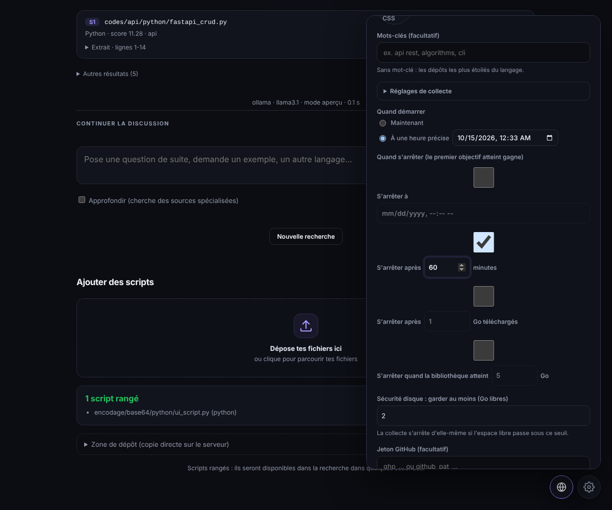

# Collecteur GitHub (crawler)



Le bouton **globe**, à côté de l'engrenage, ouvre le panneau.

## Réglages

- **Langages**, requête, nombre de dépôts / fichiers, étoiles minimum.
- **Quand démarrer** : maintenant, ou à une date/heure (heure du navigateur, convertie en UTC).
- **Quand s'arrêter** (le premier objectif atteint arrête la collecte) :
  - à une heure précise ;
  - après *x* minutes ;
  - après *x* Go téléchargés ;
  - quand la bibliothèque atteint *x* Go.
- **Sécurité disque** : la collecte s'arrête si l'espace libre passe sous `min_free_gb` (2 Go par défaut, 0,5 Go minimum). Le disque est aussi vérifié avant de commencer.
- **Jeton GitHub** (facultatif, relève la limite de débit) : enregistré **chiffré** ; jamais renvoyé au navigateur ; transmis uniquement à `api.github.com`. Sans jeton, la variable `GITHUB_TOKEN` du serveur est utilisée si elle existe.

Statuts : planifié, en cours, arrêt en cours, terminé, arrêté, échoué, annulé, interrompu (redémarrage du service), manqué (heure passée pendant une panne). Raison d'arrêt affichée : `termine`, `heure-atteinte`, `duree-atteinte`, `volume-atteint`, `bibliotheque-pleine`, `disque-presque-plein`, `arret-demande`, `limite-fichiers`, `limite-de-debit`, `erreur`.

Un seul travail à la fois. Le travail planifié est restauré au redémarrage du service.

## Où vont les fichiers

`<dossier surveillé>/github/<langage>/<dépôt>/…`, avec licence et origine conservées. Une base SQLite (`.crawler/`) mémorise ce qui est déjà téléchargé : le rangement par le moteur ne provoque pas de re-téléchargement.

## En ligne de commande

```bash
cd crawler && PYTHONPATH=src python -m icc_crawler --help
python -m icc_crawler disk-check
python -m icc_crawler crawl --dest /var/lib/imperial-codecenter/codes --language python \
    --max-gb 2 --stop-at 2026-10-20T03:00 --min-free-gb 5
```

Codes de sortie : 0 normal (budget atteint compris), 1 limite de débit / erreur / disque presque plein, 2 arguments invalides. `SIGTERM`/`SIGINT` arrêtent proprement. `--progress-json` émet des événements JSON (utilisé par l'API).

## Limites

Le collecteur a été testé avec des réponses GitHub simulées (254 tests), **pas contre le vrai GitHub** pendant le développement. Seuls les dépôts sous licence permissive sont collectés par défaut (MIT, Apache-2.0, BSD, ISC, CC0, Unlicense, Zlib, 0BSD) ; `--license` permet de changer la liste. Respecte les licences des dépôts collectés.
