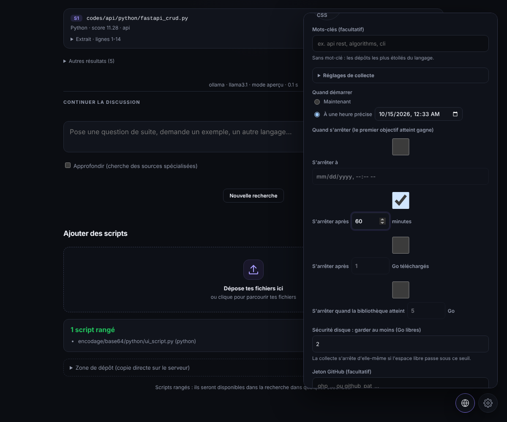

# Collecteur GitHub (crawler)



Le bouton **globe**, à côté de l'engrenage, ouvre le panneau.

## Progression en direct

Pendant une collecte, le panneau se met à jour chaque seconde : **phase** (recherche des dépôts, puis « Dépôt 3 / 12 »), barre de progression (la plus avancée des limites : fichiers, dépôts, durée, volume), **dépôt en cours** et fichiers déjà pris dans ce dépôt, volume, fichiers ignorés, erreurs, **vitesse** (fichiers/min), **temps restant estimé** et les derniers fichiers enregistrés. Pendant la recherche des dépôts, la barre est indéterminée. Le journal reste replié tant que tu ne l'ouvres pas.

## Réglages

- **Langages**, requête, nombre de dépôts / fichiers, étoiles minimum.
- **Quand démarrer** : maintenant, ou à une date/heure (heure du navigateur, convertie en UTC).
- **Quand s'arrêter** (le premier objectif atteint arrête la collecte) :
  - à une heure précise ;
  - après *x* minutes ;
  - après *x* Go téléchargés ;
  - quand la bibliothèque atteint *x* Go.
- **Sécurité disque** : la collecte s'arrête si l'espace libre passe sous `min_free_gb` (2 Go par défaut, 0,5 Go minimum). Le disque est aussi vérifié avant de commencer.
- **Jeton GitHub** (facultatif, relève la limite de débit) : enregistré **chiffré** ; jamais renvoyé au navigateur ; transmis uniquement à `api.github.com`. Sans jeton, la variable `GITHUB_TOKEN` du serveur est utilisée si elle existe.

Statuts : planifié, en cours, arrêt en cours, terminé, arrêté, échoué, annulé, interrompu (redémarrage du service), manqué (heure passée pendant une panne). Raison d'arrêt affichée : `termine`, `heure-atteinte`, `duree-atteinte`, `volume-atteint`, `bibliotheque-pleine`, `disque-presque-plein`, `arret-demande`, `limite-fichiers`, `limite-de-debit`, `erreur`.

Un seul travail à la fois. Le travail planifié est restauré au redémarrage du service.

## Où vont les fichiers

`<dossier surveillé>/github/<langage>/<dépôt>/…`, avec licence et origine conservées. Une base SQLite (`.crawler/`) mémorise ce qui est déjà téléchargé : le rangement par le moteur ne provoque pas de re-téléchargement.

## Modes NORMAL et UNSAFE

- **NORMAL** (défaut) : dépôts maximum, fichiers par dépôt, fichiers au total, durée, volume téléchargé et taille de bibliothèque sont configurables.
- **UNSAFE** (`--unsafe`, ou le sélecteur de l'interface) : aucune de ces limites ; la collecte va jusqu'à épuisement des dépôts accessibles ou arrêt manuel. Les demandes qui fixent `stop_at`, `max_minutes`, `max_gb` ou `max_library_gb` sont refusées. Restent actifs : espace libre minimal (`--min-free-gb`, au moins 1 Go), exclusion des secrets, attente de la remise à zéro des limites de débit GitHub (jusqu'à plus d'une heure) au lieu d'un arrêt, arrêt manuel (`SIGTERM`) et stockage confiné à la destination.

Les paramètres réellement appliqués sont annoncés par le crawler (événement `start`), affichés dans l'état de la collecte et comparés à la demande : tout écart est signalé et journalisé.

## Suivi des fichiers collectés

Chaque fichier est enregistré dans `<destination>/.crawler/crawler.sqlite3` (dépôt, chemin, branche, commit, SHA git du blob, SHA-256, licence, langage, catégorie, dates). Aux collectes suivantes : un fichier au même SHA est ignoré, un nouveau est téléchargé, un fichier modifié sur GitHub est mis à jour (l'ancienne version reste dans l'historique), les doublons sont évités et un fichier supprimé localement n'est pas retéléchargé. `--force` (case « Forcer la nouvelle collecte ») réexplore les dépôts déjà faits. Un dépôt n'est réexploré que si son commit, son quota par dépôt ou les filtres ont changé. GitHub n'est jamais modifié.

## Catégories

Dossier `<catégorie>[/<sous-catégorie>]/<langage>/`. Le classement automatique est heuristique ; les fichiers sans signal vont dans `non-classe`. L'onglet Bibliothèque permet de reclasser à la main (le fichier est déplacé) et de lancer une analyse IA de quelques fichiers non classés : jamais automatique, 25 fichiers au plus par lancement, `CODECENTER_AI_TAG_DAILY_MAX` appels par jour (100 par défaut, 0 = désactivée) ; un classement manuel n'est jamais écrasé.

## En ligne de commande

```bash
cd crawler && PYTHONPATH=src python -m icc_crawler --help
python -m icc_crawler disk-check
python -m icc_crawler crawl --dest /var/lib/imperial-codecenter/codes --language python \
    --max-gb 2 --stop-at 2026-10-20T03:00 --min-free-gb 5
```

Codes de sortie : 0 normal (budget atteint compris), 1 limite de débit / erreur / disque presque plein, 2 arguments invalides. `SIGTERM`/`SIGINT` arrêtent proprement. `--progress-json` émet des événements JSON (utilisé par l'API) : `start`, `progress` (phase `discovery`/`exploring`/`done`, `repos_done`/`repos_target`, `repo`, `repo_files`/`repo_quota`, `files`/`files_target`, `bytes`, `skipped`, `errors`, `recent`, `elapsed`) émis au plus une fois par seconde et immédiatement à chaque changement de phase ou de dépôt, puis `done`.

## Limites

Le collecteur a été testé avec des réponses GitHub simulées (plus de 300 tests), **pas contre le vrai GitHub** pendant le développement. Seuls les dépôts sous licence permissive sont collectés par défaut (MIT, Apache-2.0, BSD, ISC, CC0, Unlicense, Zlib, 0BSD) ; `--license` permet de changer la liste. Respecte les licences des dépôts collectés.
