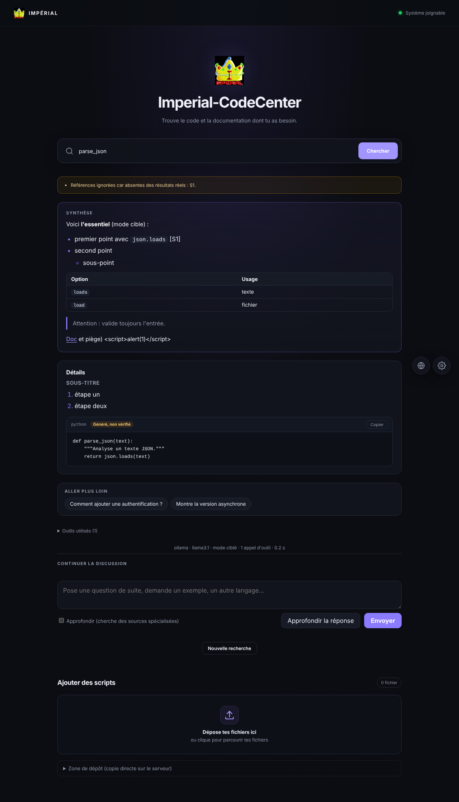

# Ajouter des scripts facilement

## Par l'interface

Section **Ajouter des scripts** : dépose des fichiers (ou une archive `.zip`), écris des **tags** sous la zone (`tag1, tag2`), valide. Aperçu du rangement en direct : `tag1 / tag2 / <langage>`.

- Les fichiers sont rangés dans `<dossier surveillé>/tag1/tag2/<langage>/fichier`.
- **Sans tag** : classement automatique par contenu (catégorie `importes` par défaut).
- Options : classement automatique, conserver l'arborescence des ZIP.
- Limites : 1 Mo par fichier, 50 Mo par envoi, nombre de fichiers plafonné (`CODECENTER_IMPORT_*`), extensions de code reconnues seulement (les autres sont signalées « ignorées »).
- ZIP : chemins dangereux (`../`), liens symboliques et archives piégées rejetés.

## Par la zone de dépôt (copie directe sur le serveur)

Le dossier `<dossier surveillé>/_depot/` est examiné toutes les 15 s (`CODECENTER_DEPOT_SECS`) ou à la demande (bouton « Ranger maintenant »).

Pour étiqueter, au choix :

1. un fichier `tags.txt` dans `_depot/` (`reseau, debug`) : s'applique à tout ce qui est déposé ;
2. un fichier `monscript.py.tags` à côté du script ;
3. des sous-dossiers : `_depot/reseau/ping.py` reçoit le tag `reseau`.

Un registre (`depot-ledger.json`) évite de ranger deux fois le même fichier ; un fichier encore en cours de copie est attendu. Les écritures sont atomiques.

## Disque

Un import est refusé sous `CODECENTER_MIN_FREE_GB` (2 Go) d'espace libre.
