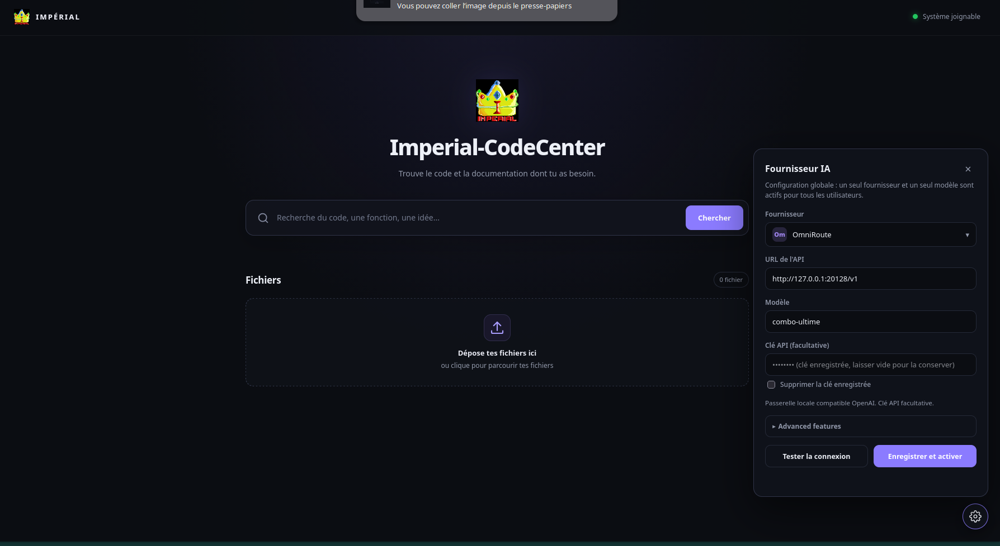
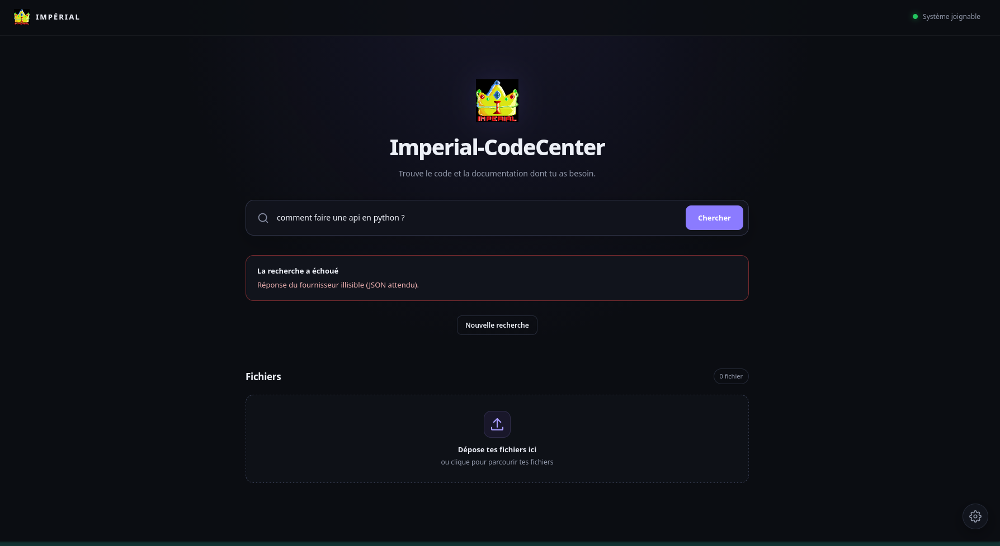

# Intelligence artificielle

## Fournisseurs

Panneau à engrenage : Ollama et OmniRoute (locaux), Claude, OpenAI, Groq, Gemini. Configuration **globale** (un fournisseur et un modèle actifs pour tous). Les clés sont chiffrées et jamais renvoyées au navigateur. Voir le `README.md` racine pour les particularités de chaque protocole.

### OmniRoute : « Réponse du fournisseur illisible (JSON attendu) »

Cause : OmniRoute (passerelle compatible OpenAI) peut répondre en flux SSE (`data: {...}`), ou avec une page HTML (erreur de la passerelle, mauvaise URL), au lieu d'un JSON simple. Le connecteur gère maintenant les flux SSE et signale clairement une réponse HTML (URL à vérifier, souvent `http://127.0.0.1:20128/v1`, ou combo/modèle inexistant). Vérifications : `curl http://127.0.0.1:20128/v1/models`, le nom exact du modèle (`combo-ultime`), la clé si la passerelle en exige une, puis « Tester la connexion ».

## Profondeur : l'IA cherche selon ta question

`depth.py` évalue la demande :

| Mode | Quand | Effet |
|---|---|---|
| **Aperçu** | question générale (« comment faire une API en Python ? ») | explication simple et courte, peu de sources (6 recherchées, 3 jointes), 2 appels d'outils max. **Ne cherche pas** les sujets avancés (chiffrement, authentification…). |
| **Ciblé** | question précise (nom de fonction, erreur, langage) | comportement standard. |
| **Approfondi** | tu creuses (« détaille », « chiffrer l'API », case « Approfondir », bouton « Approfondir la réponse ») | davantage de sources (8 jointes) et d'outils, sources spécialisées. |

Le mode utilisé est affiché sous la réponse. On peut le forcer : champ `depth` (`auto`, `overview`, `focused`, `deep`).

## Chatbox après la recherche

Sous la réponse, **Continuer la discussion** : pose une question de suite, demande un exemple ou un autre langage. L'IA garde l'historique (20 tours) et peut **toujours utiliser ses outils** (`search_code`, `read_file`…). Des pistes **« Aller plus loin »** (cliquables) sont proposées par l'IA.

Limites : les conversations sont **en mémoire du serveur** (2 h d'inactivité, 200 conversations max, 300 sources max par conversation) et disparaissent au redémarrage ; une seule requête à la fois par conversation.

## Affichage Markdown

Titres, gras/italique, listes imbriquées, tableaux, citations, code (avec bouton **Copier**), liens `http(s)`/`mailto` seulement, références `[S1]` vers les sources. Le rendu est construit en DOM avec `textContent` : le HTML renvoyé par un modèle (`<script>`, `javascript:`) n'est jamais interprété.

## Statut « analysis_pending »

Un fichier peut apparaître en attente d'analyse après son indexation : c'est normal et sans effet sur la recherche.
